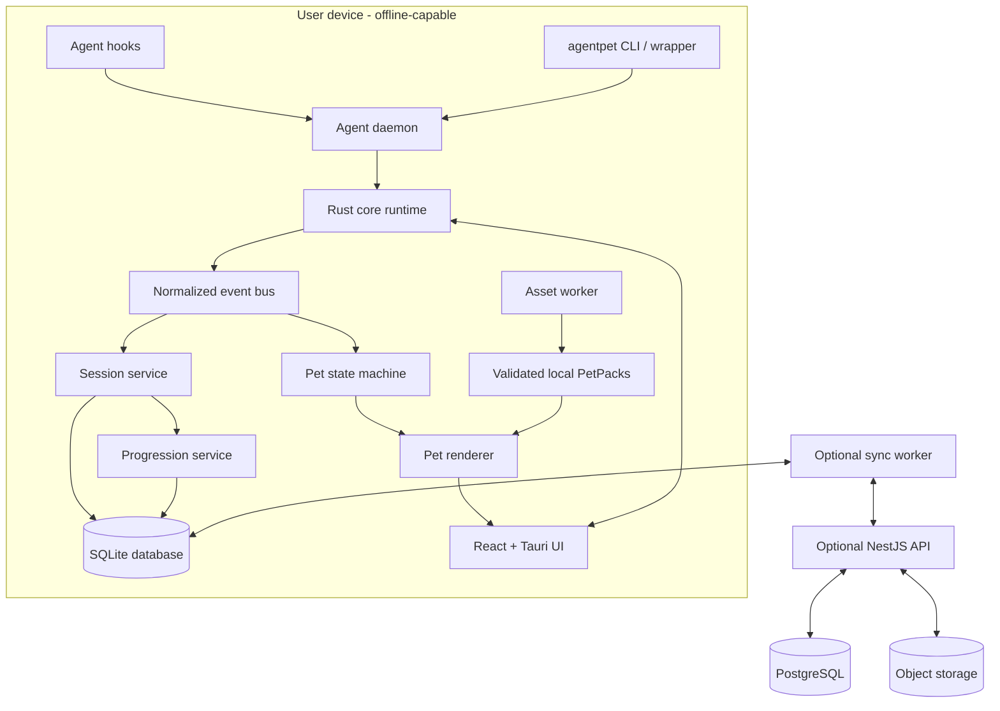

# AgentPet Platform Architecture

## 1. Purpose and scope

This document defines the target architecture for an offline-first desktop companion platform. The workspace now contains an initial Tauri/React shell, Rust SQLite runtime core, and partial v1 manifest validator; the wider modules below remain target architecture until implemented and verified.

The desktop application must work without an account or network connection for pet rendering, agent event capture, local session history, progression, settings, and locally installed PetPacks. Cloud features are optional and must not be required for startup or local progress.

## 2. Architecture decisions

| Concern | Selected implementation | Boundary |
| --- | --- | --- |
| Cross-platform desktop | Tauri 2 | Native windows, tray, notifications, OS adapters, capability-scoped IPC |
| Desktop UI | React + TypeScript strict mode | Presentation, user input, accessible settings and dashboards |
| Domain/runtime | Rust workspace crates | Events, pet state, sessions, progression, pack validation, orchestration |
| Local persistence | SQLite, accessed through Rust | Durable local records and migrations; UI never opens the database directly |
| Agent integrations | Rust adapter crates plus hook/CLI processes | Convert real provider/agent data into normalized events |
| Local event transport | Authenticated per-user Unix socket or Windows named pipe | Hook, CLI, and daemon communication; bounded, versioned messages |
| Asset work | Rust background worker | Decode, validate, resize, and package images without blocking UI |
| Optional cloud API | NestJS modular monolith + PostgreSQL | Accounts, community library, reports, and sync endpoints |
| Optional cloud assets | Private object storage + CDN | Validated public PetPack assets, delivered by signed/versioned manifest |

Use one Tauri desktop application on macOS, Windows, and Linux. OS-specific behavior belongs behind Rust platform adapters. Desktop shell calls are explicit Tauri commands; there is no generic shell execution command exposed to the UI.

## 3. System context



## 4. Repository layout and ownership

```text
apps/
  desktop/
    src/                       # React and TypeScript UI
    src-tauri/                 # Tauri bootstrap, commands, capabilities
  web/                         # Optional community and account frontend

crates/
  app-core/                    # Composition root and application services
  event-engine/                # Event types, validation, priority, deduplication
  pet-engine/                  # Explicit state machine and animation selection
  pet-pack/                    # Pack schema, parsing, validation, migration
  agent-sdk/                   # Agent adapter traits and normalized events
  provider-sdk/                # Provider/model configuration contracts
  progression/                 # XP ledger, levels, achievements, streaks
  database/                    # SQLite migrations, repositories, transactions
  ipc/                         # Local transport, framing, authentication
  cli/                         # CLI and universal process wrapper
  platform/                    # OS-specific window, credential, notification adapters

services/
  agent-daemon/                # Hook and CLI event receiver
  asset-worker/                # Image, animation, and archive processing
  sync-worker/                 # Optional durable cloud sync

cloud/
  api/                         # Optional NestJS modular monolith
  migrations/                  # PostgreSQL schema migrations

packages/
  contracts/                   # Schemas and generated TypeScript contracts
  ui/                          # Shared React components
  i18n/                        # UI and speech message catalogs

pet-packs/
  starter/                     # Licensed data-only starter pack, if rights permit

infra/
  docker/
  terraform/
  github-actions/
docs/
```

Dependency direction is inward: app shells and platform adapters depend on domain crates; domain crates do not depend on the UI, database implementation, cloud SDK, or a specific character. `app-core` wires interfaces to implementations. Avoid circular dependencies. The desktop UI consumes generated or schema-validated contracts rather than duplicating Rust business rules.

## 5. Runtime processes

### Desktop process

Tauri owns the pet window, settings/dashboard windows, tray/menu integration, notifications, and explicit IPC commands. It loads the minimum state needed to show the selected pet promptly. Agent discovery, library indexing, cloud checks, and large asset work run asynchronously after first paint.

### Core runtime and daemon

The Rust core owns accepted event ordering, session lifecycle, persistence, the pet state machine, and progression. The local daemon receives events from agent hooks and the CLI. It authenticates local clients using OS permissions plus a per-install random secret held in a restricted local file or OS credential store. It limits payload size, validates protocol version, and never logs prompts, terminal output, or credentials.

The initial `agentpet run -- <command>` CLI opens the same local SQLite database directly, records a universal session, streams child stdout/stderr to the corresponding terminal streams, and stores completion/failure plus exit status. Successful completion grants configured XP atomically with the session and event update. Native hook transport and provider-specific parsers are not implemented yet. The wrapper does not persist terminal output or infer token counts.

The initial deployment may host core and daemon in one process if platform lifecycle is simpler. Their protocol and crate boundaries remain explicit so they can be split into supervised services without changing domain logic.

### Asset worker

Static user-image decoding, resize, preview generation, and install currently run on a Rust blocking worker invoked asynchronously by Tauri. Input size, dimensions, and decoder allocation are bounded. GIF uploads currently use the first decoded frame. Separate animation extraction, archive validation, and long-running job progress remain planned. Installing a pack is atomic: validate in staging, then move into the installed library and record the installation transaction.

### Optional cloud services

The cloud is a modular monolith at first. Modules own auth, profiles, library/versioning, reporting/moderation, and sync. Split services only after scale or operational requirements justify it. Cloud availability never blocks local desktop startup.

## 6. Event architecture

All event sources produce a versioned normalized event. Adapters must not send raw provider payloads into the pet engine.

```text
PetEvent {
  id: UUID,
  schemaVersion: integer,
  type: enum,
  occurredAt: UTC timestamp,
  receivedAt: UTC timestamp,
  source: string,
  projectId?: UUID,
  sessionId?: UUID,
  agentId?: string,
  priority: Critical | High | Normal | Low | Background,
  metadata: validated type-specific object
}
```

Examples include `AGENT_STARTED`, `AGENT_WORKING`, `AGENT_WAITING`, `AGENT_INPUT_REQUIRED`, `AGENT_COMPLETED`, `AGENT_FAILED`, `TOOL_FAILED`, `BUILD_SUCCESS`, `TEST_FAILED`, `GIT_COMMIT`, `TOKEN_USAGE`, `SESSION_COMPLETED`, `USER_INTERACTION`, `LEVEL_UP`, and `ACHIEVEMENT_UNLOCKED`.

Processing order:

1. Authenticate source and validate protocol/schema.
2. Deduplicate by event ID or source idempotency key.
3. Persist the event and update the session in a transaction.
4. Publish the accepted event to in-process subscribers.
5. Apply state-machine transition and progression rules.
6. Emit renderer, notification, and dashboard updates.

Persist-before-ack prevents accepted events from disappearing across a crash. Replays are safe because event handling, XP transactions, achievements, and sync records have unique idempotency constraints.

## 7. Pet state machine

The pet engine uses explicit states: `Idle`, `Working`, `Thinking`, `Waiting`, `Success`, `Error`, `Celebrating`, `Sleeping`, `Hungry`, `Eating`, `LevelUp`, `Achievement`, `Offline`, `Paused`, and `AttentionRequired`.

Each state definition supplies entry/exit actions, animation key, speech message category, optional sound key, priority, duration, interruptibility, and allowed transitions. A transition is selected from the current state, incoming event, priority, and configured policy. Do not model state using independent booleans or let the renderer infer domain state.

Higher-priority failures and approval requests can interrupt low-priority idle or token updates. Timed states use a persisted entry time and return through an explicit transition. Missing animation mappings use a pack-defined fallback, then a neutral idle presentation; they do not crash the renderer.

Current implementation (`crates/pet-engine`, crate `agentpet-pet-engine`):

- The engine is pure and has no I/O. `PetEngine::definition` gives each state a priority (`Background < Low < Normal < High < Critical`), an interruptible flag and an optional timeout. `allows` is the explicit transition table.
- `decide(current, stimulus, context)` returns `Enter`, `Remain` or `Rejected`. A non-interruptible state (`LevelUp`, `Achievement`, `Paused`) yields only to a strictly higher-priority target or to an explicit user pause/resume. Deferred reactions are dropped, not queued.
- Timed states return to rest: `Working` while any session is running, otherwise `Idle`. These are `Success`, `Error`, `Celebrating`, `LevelUp` and `Achievement`. `Idle` falls asleep after 15 minutes. Durations come from a validated `StatePolicy`.
- `agentpet-core` persists the entry time in `pet_state.state_entered_at` (UTC wall clock, so timers survive restarts). It applies expiries before every stimulus and through `Core::advance_state_timers`, which the desktop shell calls once per second on a background thread. A missing or future entry time counts as already expired.
- Session lifecycle writes always persist session facts. A presentation transition the engine rejects or defers leaves the pet state unchanged instead of failing the session update. Direct `accept_event` calls still reject invalid transitions.
- Finishing a session reacts with `LevelUp`, then `Achievement`, then `Success` on success, and `Error` on failure.
- Animation selection (`select_animation`) walks the state followed by its fallback chain (for example `LevelUp → Celebrating → Success → Idle`). For each candidate it checks the pack's `stateMappings` first, then an animation with the same name. Keys are matched case-insensitively, ignoring non-alphanumerics. If nothing matches, it uses the first animation.
- Not yet implemented: per-state speech/sound, a user-facing pause/resume control, a reaction queue, and `Hungry`/`Eating` stimuli.

## 8. Agent and provider boundaries

An `AgentAdapter` recognizes and parses one coding agent's real hooks, structured output, or process lifecycle. It emits normalized agent/session/tool events. Adapter installation and removal must preserve unrelated user configuration and be reversible. Parsing is based on documented formats; unsupported payloads produce diagnostics instead of fabricated states.

The universal wrapper launches the requested child process, captures stdout/stderr without changing their meaning, records start/end/duration and exit code, associates the working directory with a project, and returns the original child exit status. A process still running is not reported as completed. Token usage is absent unless supplied by a real source.

AI `Provider` configuration is separate from agent integration. Providers describe endpoint, model, capabilities, timeout, retry policy, and a credential reference. API keys are stored only in the platform credential store (Keychain, Credential Manager, or Secret Service). They never enter SQLite, logs, frontend state, URLs, or telemetry.

## 9. PetPack and character system

The runtime consumes generic, validated PetPacks. Character names and artwork do not appear in business logic. The starter character is selected through initial settings and is replaceable immediately.

PetPacks are data-only. Accepted content is limited to schema-defined JSON, supported images, and explicitly supported audio/font assets. Reject scripts, executables, libraries, unknown payloads, path traversal, unsupported MIME types, malformed manifests, excessive archive ratios, excessive dimensions, and excessive decoded memory use. The manifest declares schema version, identity, author, license, attribution/source, asset paths, animations, and compatible engine range.

Pack install flow: download or import to staging, inspect archive paths and limits, parse and migrate manifest, validate license metadata and assets, generate indexes/previews, atomically install, then expose as selectable. Never execute downloaded pack content. Community publishing additionally requires report/takedown handling and moderation policy.

Animation definitions are data-driven: frames, frame rate, loop behavior, duration, scale, offset, anchor, and optional sound key. State-to-animation mappings are configurable per pet instance. The renderer operates on validated animation data only.

The current Tauri shell has a dedicated `pet-overlay` webview, configured transparent, frameless, always-on-top, and hidden from the taskbar where supported. The main window reveals it through the explicit `show_pet_overlay` command. The overlay polls local runtime state, requests the selected pack animation, supports native drag movement, and hides through the Tauri window API. Physical coordinates are debounced into SQLite settings and restored on launch; if the previous monitor is unavailable, the position is moved onto the primary monitor's visible work area. It does not expose shell execution or arbitrary window creation to the frontend.

Image-to-pet processing supports static images first, then sprite sheets and supported animated formats. Processing reports actual capabilities: a single image becomes a static pet; it is not described as animated unless frames/animations are created and validated.

## 10. Local data model

SQLite is accessed through the Rust database crate. Enable foreign keys and use migrations with recorded schema versions. Important tables include:

```text
projects, project_pet_assignments
installed_pet_packs, pet_assets, pet_instances, animation_mappings
agents, agent_sessions, agent_events
providers, provider_models, provider_usage
xp_transactions, levels, achievements, pet_achievements, streaks
notifications, settings, custom_messages, favorites, installed_pet_packs
audit_logs, schema_versions, sync_queue
```

Use constraints and indexes for stable IDs, event idempotency, project lookup, session time queries, and pack versions. Apply multi-record updates transactionally. The current local migrations create schema versions 1 through 6, including pet runtime state with its state entry time (v6), installed PetPacks, agent session lifecycle records, progression rules, immutable XP transactions, and materialized levels. Each session captures its active pet identity when it starts. XP history is append-only; the current balance is derived or materialized from immutable transactions. Only real successful process completions currently award XP; token usage remains unknown unless an adapter reports measured values. Use retention cleanup for session/event history, with a configurable default of 90 days. Never delete progression ledger records as part of ordinary session retention.

Provider credentials are not stored in this schema. Audit records contain action type, timestamp, actor/source, and safe metadata, never secret values or private prompt content.

## 11. IPC and cloud API

Tauri capabilities allow only the commands required by each window. Commands are explicit, typed, validated, and return stable error codes. Examples: `get_pet_state`, `list_pets`, `install_pet_pack`, `remove_pet_pack`, `list_agents`, `get_sessions`, `assign_project_pet`, and `update_settings`. No unrestricted filesystem or process command is exposed to the renderer.

Cloud APIs are versioned under `/api/v1`, documented with OpenAPI, and use pagination, input/output validation, idempotency keys for mutating requests, rate limits, and structured errors. WebSockets are reserved for live dashboard updates; REST handles standard queries and writes. Errors include a stable code and request ID but never stack traces or secrets.

## 12. Sync and conflict handling

Sync is opt-in and uses an outbox/inbox model. Every sync record includes device ID, event ID, revision, timestamp, and idempotency key. Upload only explicitly allowed fields. Do not upload source code, prompts, terminal output, API keys, private files, or full project paths. Project display names and paths require clear opt-in and minimization.

Append-only XP/progression merges by unique transaction ID and moves forward. Mutable preferences use documented revision/timestamp conflict policy. A conflict cannot reduce level, erase an achievement, or silently overwrite a newer local record. Offline edits remain queued until sync resumes. Failed sync retries use bounded exponential backoff and are visible in diagnostics.

## 13. Security and privacy boundaries

- Pet packs are untrusted data; all parsing and resource use are bounded.
- Agent hooks are least-privilege and reversible; they do not read project files.
- Local IPC authenticates same-user clients and rejects oversized or stale protocol messages.
- Tauri shell and filesystem capabilities are allowlisted by operation and path.
- Credentials live in OS secure storage, referenced by opaque IDs.
- Logs and crash reports redact tokens, secrets, prompts, terminal output, and sensitive paths.
- Network calls are limited to explicit optional cloud features and user-configured providers.
- Cloud API applies authentication, authorization, rate limits, validation, audit logging, and abuse reporting.
- Community library entries require license/source/attribution metadata and support moderation and takedown.

## 14. Reliability and performance

Show the pet using locally available state before initializing integrations or network services. Keep image processing, database-heavy reporting, and sync off UI threads. Virtualize long library/session lists. Bound event queues and batch low-priority updates while preserving critical events. Use atomic pack installation, SQLite transactions, graceful process shutdown, and recovery of unfinished sessions after restart.

Target smooth 60 FPS animation where the platform permits, low idle CPU/RAM, and no synchronous large-file work on the UI thread. Instrument state transitions, adapter failures, pack install failures, IPC errors, and sync failures with privacy-safe structured logs and counters.

## 15. Testing strategy

- Unit tests: state transitions, priority arbitration, event normalization/deduplication, progression ledger replay, levels, pricing, pack validation, schema migration, sync merge.
- Integration tests: SQLite repositories/migrations, local IPC authentication, each agent adapter fixture, wrapper exit-code preservation, asset worker, Tauri command validation.
- End-to-end tests: offline launch, pet selection, custom static image import, agent real event fixtures, waiting/success/failure flows, XP idempotency, project assignment, restart recovery, optional sync.
- Security tests: archive traversal/zip bombs, oversized images, malformed manifests, credential leakage, command injection, unauthorized IPC, rate limits, and capability checks.
- Platform checks: window transparency/always-on-top behavior, DPI/monitor changes, notifications, credential store, and packaged startup on each supported OS.

Tests must exercise actual adapter parsers and process behavior. Fixtures may represent known agent outputs; production code must never generate simulated token counts or session completion.

## 16. Delivery phases

1. **Foundation:** workspace, Tauri shell, Rust core, React UI, SQLite migrations, typed IPC, tray/window behavior, offline startup.
2. **Pet runtime:** explicit state machine, renderer, data-only PetPack, asset worker, starter pack, customization and immediate replacement.
3. **Agent integrations:** durable local event daemon, universal wrapper, documented hooks/adapters, real session persistence.
4. **Progression:** immutable XP ledger, levels, achievements, streaks, project pets, local analytics.
5. **Library:** search and virtualized browsing, local install/import, image creation pipeline, licensing and moderation metadata.
6. **Optional cloud:** NestJS modules, auth, library publishing, sync protocol, conflict handling, web dashboard.
7. **Hardening:** security review, diagnostics, crash recovery, CI, signing, SBOM, platform installers, signed updates and rollback.

No phase is complete based on UI alone. A feature is complete only when its UI, domain logic, persistence or external contract, validation, error handling, and required tests are integrated.

## 17. Release architecture

GitHub Actions should run formatting, linting, strict TypeScript checks, Rust Clippy, unit/integration tests, security and dependency scans, then build platform artifacts. Release jobs produce SBOMs, checksums, signed artifacts, and signed update metadata. Updates verify signatures and compatibility before installation and support rollback. macOS, Windows, and Linux packaging/signing requirements are platform-specific and must be validated on their respective runners.

Cloud deployment is separate from desktop release. Docker Compose supports local API/PostgreSQL development. Production deployment uses managed PostgreSQL, object storage/CDN, backups, migration gates, health checks, and tested restore procedures. Core desktop behavior remains available if all cloud infrastructure is unavailable.
