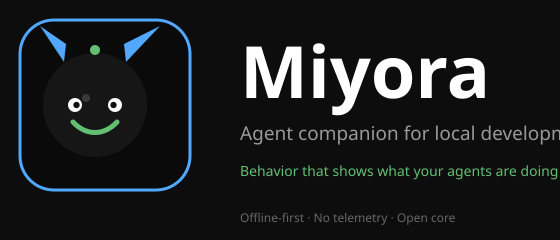

<p align="center">
  
</p>

<p align="center">
  <a href="#features"></a>
  <a href="#architecture"></a>
  <a href="#features"></a>
  <a href="#features"></a>
  <a href="#architecture"></a>
  <a href="#security--privacy"></a>
  <a href="#quality-gates--test-suite"></a>
</p>

---

### **Agent behavior, made visible.**

**Miyora** is an offline-first, native desktop companion that tracks AI coding agent activity in real time. It observes actual process lifecycle and tool invocations, translates those signals into an authoritative 15-state behavior engine, and renders responsive 3D procedural avatars and animated sprite companions over a transparent desktop overlay.

Session evidence, progression metrics, and XP transactions are committed to an immutable local SQLite ledger with zero cloud dependencies and zero telemetry.

---

## 📑 Table of Contents

- [Key Capabilities](#-key-capabilities)
- [System Architecture](#-system-architecture)
- [3D Avatar Generation (Tripo 3D API)](#-3d-avatar-generation-tripo-3d-api)
- [Event Pipeline & Hook Subsystem](#-event-pipeline--hook-subsystem)
- [Pet State Machine](#-pet-state-machine)
- [Companion Universe & PetPacks](#-companion-universe--petpacks)
- [CLI Reference](#-cli-reference)
- [Quick Start & Installation](#-quick-start--installation)
- [Quality Gates & Test Suite](#-quality-gates--test-suite)
- [Security, Privacy & Sandboxing](#-security-privacy--sandboxing)
- [Technical Documentation](#-technical-documentation)
- [License & Attribution](#-license--attribution)

---

## ⚡ Key Capabilities

| Pillar | Description |
| :--- | :--- |
| **🖥️ Native Desktop Shell** | Powered by **Tauri 2** and React strict TypeScript. Features an interactive main management window and a transparent, non-intrusive, always-on-top pet overlay with persistent screen coordinates. |
| **👁️ Real Agent Observation** | Real-time observation through zero-overhead native hooks (**Claude Code**, **Codex**) or the universal process wrapper (`agentpet run -- <command>`) for any agent (Aider, OpenCode, Gemini CLI). No synthetic or mock activity. |
| **🧠 Deterministic Finite State Machine** | 15-state priority-based reactive engine (`pet-engine`) enforcing strict transition allow-lists. Distinguishes active execution, deep reasoning, human attention requests, errors, and task victories. |
| **🎭 3D Studio & 2D PetPacks** | Includes **167 procedural 3D characters** across 5 body archetypes with customizable rigs (ears, tails, auras, props, gradient hair), local silhouette-inflation sculpting from 2D images, VRM imports, and **47+ standalone PetPacks**. |
| **🛡️ Tamper-Safe Progression** | Idempotent local XP ledger awarding XP strictly on verified child process completion. Session XP, level scaling, and milestone achievements are committed together in atomic SQLite transactions. |
| **🔒 Air-Gapped Privacy** | No cloud account required. Zero background telemetry. Prompts, raw tool outputs, API keys, and sensitive filesystem paths are scrubbed before persistence. |

---

## 🏗️ System Architecture

Miyora enforces strict unidirectional boundaries. Rust domain crates own all authoritative state, persistence, event normalization, and crypto verification. The React UI accesses business logic exclusively through narrow, capability-scoped Tauri IPC commands.

<p align="center">
  
</p>

### Domain & Crate Boundaries

```
miyora (workspace root)
├── apps/desktop/                  # Tauri 2 Desktop Shell (Rust host + React strict TS)
│   ├── src/                       # Main Command Deck & transparent overlay UI
│   ├── src/avatar/                # 3D Character Studio, Three.js procedural rigs & shaders
│   └── src-tauri/                 # Window lifecycle, capabilities, local IPC listeners
├── crates/agentpet-core/          # SQLite persistence, session lifecycle, immutable XP ledger
├── crates/pet-engine/             # 15-state reactive behavior engine & transition allow-list
├── crates/agentpet-adapters/      # Claude Code / Codex hooks & universal process wrapper
├── crates/pet-pack/               # Ed25519 signature checks, manifest parser, image normalization
└── crates/agentpet-cli/           # Diagnostic CLI (`agentpet`) for headless execution and doctor checks
```

---

## 🎨 3D Avatar Generation (Tripo 3D API)

Miyora features an original 3D anime avatar generation pipeline powered by the **Tripo 3D API** and **Blender** post-processing. Rather than fabricating primitive meshes (such as cubes, spheres, or cylinders), the system calls Tripo's state-of-the-art text-to-3D and image-to-3D generation endpoints, polls the asynchronous job, and downloads clean game-ready GLB models.

### Getting a Tripo API Key

1. Visit [platform.tripo3d.ai](https://platform.tripo3d.ai) and sign up for an account.
2. Navigate to your Developer Settings or API Keys dashboard.
3. Generate a new API token.

### Setting the Environment Variable

The API key is securely loaded from the `TRIPO_API_KEY` environment variable. Never hard-code your key in source files or commits.

**Windows PowerShell:**
```powershell
$env:TRIPO_API_KEY = "your_tripo_api_key_here"
```

**Linux / macOS (Bash / Zsh):**
```bash
export TRIPO_API_KEY="your_tripo_api_key_here"
```

### Running Text-to-3D Generation

Convert user text requests into fully detailed, original anime 3D models:

```powershell
python avatar_workflow.py --prompt "anime girl with pink hair"
```

The system automatically runs `anime_character_prompt.py` to expand short user descriptions into production-grade prompts (e.g. `Original full-body 3D anime-style girl character, long pink hair, large expressive eyes, stylish modern outfit, clean silhouette, appealing stylized proportions, T-pose, symmetrical face, high-quality PBR textures, clean topology, game-ready 3D model`), while guaranteeing that no copyrighted franchise character names (Nezuko, Naruto, Goku, Pikachu, etc.) are requested.

### Running Image-to-3D Generation

Create a 3D avatar from an uploaded local reference image or remote URL:

```powershell
# Local file
python avatar_workflow.py --image "assets/reference_character.png"

# Remote URL
python avatar_workflow.py --image "https://example.com/character.png"
```

### Where Generated Models Are Saved

All generated assets are saved under `/output/models/`:
- **3D Model**: `output/models/<task_id>.glb` (standard PBR textured binary glTF)
- **Rendered Preview**: `output/models/<task_id>_rendered.png` (studio-lit transparent render)

### Post-Processing Architecture

Blender post-processing (`blender_postprocess.py`) is reserved exclusively for presentation adjustments:
- Importing and inspecting the downloaded mesh
- Centering the geometry at origin and scaling to standard character height (1.8 units)
- Positioning three-point studio lighting (Key, Fill, and Anime Rim lights)
- Framing the camera for a complete full-body T-pose preview render
- *It strictly does not rebuild the character or generate procedural mesh primitives.*

---

## 🔄 Event Pipeline & Hook Subsystem

Miyora connects to AI coding agents via low-latency, deterministic event normalization. Events persist to the local write-ahead log before acknowledgement.

<p align="center">
  
</p>

1. **Native Hooks (`Claude Code`, `Codex`)**: Installed reversibly without mutating unrelated user settings. Submits JSON payloads to the CLI hook runner.
2. **Universal Child Wrapper (`agentpet run`)**: Spawns real child processes, bidirectionally streams stdout/stderr, measures duration, and captures authentic exit codes.
3. **Privacy Scrubbing & Normalization**: Strips project directory paths, tool arguments containing secrets, and raw prompts into normalized events stamped with deterministic UUIDv5 identifiers.
4. **Local IPC (v1)**: High-speed length-prefixed transport via named pipes (Windows) or Unix domain sockets with shared-secret handshake and 256 KiB frame limits.

---

## 🎮 Pet State Machine

The companion’s mood and posture directly mirror real agent workload. Transitions are governed by an explicit state matrix in `crates/pet-engine`:

<p align="center">
  
</p>

### State Hierarchy & Response Triggers

| Priority | State | Trigger Condition | Visual Behavior |
| :---: | :--- | :--- | :--- |
| **P0** | `Error` | Non-zero exit code or adapter failure notification | Agitated posture, alert icon, error reaction |
| **P1** | `AttentionRequired` | Tool approval prompt or interactive confirmation needed | Waving, beacon emote, waiting for developer input |
| **P2** | `Celebrating` / `Success` | Process completed with exit code 0 | Cheerful celebration, victory particle burst |
| **P3** | `Thinking` | Pre-tool reasoning, model inference phase | Contemplative pose, gear/spark particle pulse |
| **P4** | `Working` | Tool execution, file write, compilation, shell command | Focused typing, weapon/wand wield, energetic stance |
| **P5** | `Idle` / `Sleeping` | Inactivity timeout (> 15 minutes of quiet session) | Relaxed breathing, seated position, gentle Zzz aura |

---

## 🐾 Companion Universe & PetPacks

Miyora ships with rich 2D sprite packs and a comprehensive procedural 3D avatar engine. Packs are completely data-driven: manifests declare author attribution, license metadata, frame dimensions, and state mappings.

### Featured Companions (47+ Built-in Packs)

<table align="center">
  <tr>
    <td align="center" width="16%">
      <br />
      <b>Nezuko</b><br />
      <sub>Anime Archetype</sub>
    </td>
    <td align="center" width="16%">
      <br />
      <b>Arjuna</b><br />
      <sub>Mythic Archer</sub>
    </td>
    <td align="center" width="16%">
      <br />
      <b>Gojo</b><br />
      <sub>Special Grade</sub>
    </td>
    <td align="center" width="16%">
      <br />
      <b>Frieren</b><br />
      <sub>Mage Companion</sub>
    </td>
    <td align="center" width="16%">
      <br />
      <b>Denji</b><br />
      <sub>Hybrid Hunter</sub>
    </td>
    <td align="center" width="16%">
      <br />
      <b>Anya</b><br />
      <sub>Esper Chibi</sub>
    </td>
  </tr>
</table>

### 3D Character Studio Capabilities

- **167 Procedural Characters**: 5 body types, 30 popular archetypes, and 25 pocket chibi creatures.
- **Parametric Customization**: 12 ear types, 10 dynamic tails (flame, star, leaf), 12 gradient hairstyles, 15 outfits, 20 accessories, and energy aura customization.
- **Geometric Image-to-3D Sculpting**: Local silhouette-inflation sculpts flat images into watertight textured GLB models without sending photos to cloud APIs.
- **VRM 1.0 Import**: Safe avatar loading with polygon-budget guardrails, metadata inspector, and humanoid retargeting.

---

## 💻 CLI Reference

The unified command-line tool `agentpet` handles headless operation, automated wrapping, diagnostics, and hook integration:

```bash
# Verify system dependencies, database integrity, and installed agent hooks
cargo run -p agentpet-cli -- doctor

# Wrap any agent command with automatic telemetry capture and XP allocation
cargo run -p agentpet-cli -- run -- claude-code

# Inspect current companion state, active sessions, and XP progression
cargo run -p agentpet-cli -- status

# List and inspect installed PetPacks
cargo run -p agentpet-cli -- pets list

# Install native agent adapter hooks
cargo run -p agentpet-cli -- agents install claude_code
```

### Full Command Specification

| Command | Arguments | Purpose |
| :--- | :--- | :--- |
| `agentpet doctor` | — | Validates local SQLite accessibility, Tauri paths, and discovers installed agent CLIs (`claude`, `codex`, `aider`, `gemini`). |
| `agentpet run` | `-- <cmd> [args...]` | Spawns child process, redirects stdio streams, records execution metrics, and awards XP on success. |
| `agentpet status` | — | Outputs currently selected companion, current level, lifetime XP, and active session status. |
| `agentpet pets` | `list` | Lists all local packs, signature validity, and highlights the active companion. |
| `agentpet agents` | `list` | Displays supported agent adapters and live registration status. |
| `agentpet agents` | `install <id>` | Registers native hook for `claude_code` or `codex` with reversible configuration backups. |
| `agentpet agents` | `remove <id>` | Safely removes hook configuration without altering unrelated user settings. |
| `agentpet hook` | `--adapter <id>` | Headless ingest parsing agent hook payloads over stdin into the normalized core. |

---

## 🚀 Quick Start & Installation

### Prerequisites

- **Rust**: `1.75+` (with `cargo` and `clippy`)
- **Node.js**: `18.0+` (LTS recommended)
- **C++ Build Tools**: Platform-specific C++ compiler (MSVC on Windows, Xcode on macOS, build-essential on Linux)

### Setup & Launch

```powershell
# 1. Clone the repository
git clone https://github.com/dinesh-nikam/Miyora.git
cd Miyora

# 2. Install desktop dependencies
cd apps/desktop
npm install

# 3. Launch desktop companion in development mode
npm run tauri:dev
```

### Headless CLI Setup

```powershell
# Run the diagnostic doctor from workspace root
cargo run -p agentpet-cli -- doctor
```

---

## 🧪 Quality Gates & Test Suite

All code in Miyora adheres to strict static verification and testing thresholds:

```powershell
# Execute Rust test suite across all workspace crates
cargo test --workspace
# Output: 112 passed, 0 failed

# Run frontend unit & avatar rig tests
cd apps/desktop
npx vitest run
# Output: 225 passed, 0 failed

# Validate strict static analysis & formatting
cargo clippy --workspace --all-features --all-targets -D warnings
cargo fmt --check --all
npm run build
```

---

## 🔐 Security, Privacy & Sandboxing

Miyora is designed with zero-trust architectural boundaries:

1. **Air-Gapped Local Storage**: All sessions, events, and progression live in an offline SQLite database accessed exclusively by Rust domain code.
2. **Untrusted Pack Sandboxing**: PetPacks contain only declarative assets (JSON, PNG, GLB, SVG). Pack scripts and native binaries are strictly rejected.
3. **Payload Sanitization**: File contents, terminal buffers, API tokens, and sensitive system credentials are never captured, logged, or uploaded.
4. **Idempotent Ledgers**: XP transactions require cryptographically safe idempotency keys, preventing replay attacks or inflated leveling.

---

## 📚 Technical Documentation

Deep dive into the architecture and specifications:

- 📐 [ARCHITECTURE.md](ARCHITECTURE.md) — Comprehensive technical stack, data flow, and IPC boundary designs.
- 📦 [PET_PACK_SPEC.md](PET_PACK_SPEC.md) — Data-only PetPack schema, animation mapping, and signature protocol.
- 🎨 [docs/specs/avatar_3d.md](docs/specs/avatar_3d.md) — 3D avatar catalog, procedural joint rigging, and silhouette sculpting.
- 🔌 [AGENT_PROVIDER_SPEC.md](AGENT_PROVIDER_SPEC.md) — Agent adapter specifications, hook payloads, and child wrapper contracts.
- 🗄️ [DATABASE.md](DATABASE.md) — Local SQLite schema, migration policies, and indexing rules.
- 📡 [API.md](API.md) — IPC message format, shared secret handshakes, and wire frames.
- 🛡️ [SECURITY.md](SECURITY.md) & [PRIVACY.md](PRIVACY.md) — Threat model, redaction rules, and credential handling.
- 🤝 [CONTRIBUTING.md](CONTRIBUTING.md) — Contribution guidelines and development workflows.

---

## 📄 License & Attribution

Distributed under dual **MIT** / **Apache-2.0** licensing. See [LICENSES.md](LICENSES.md) for details.

Miyora character models, original art packs, and procedural rig assets are distributed under Creative Commons attribution licenses as specified in their respective pack manifests.

<p align="center">
  
</p>
