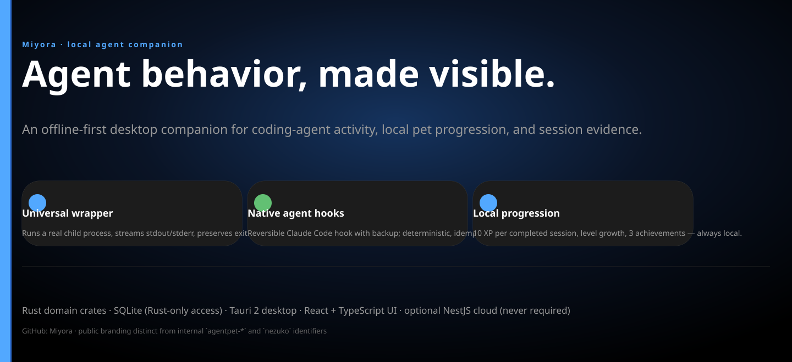
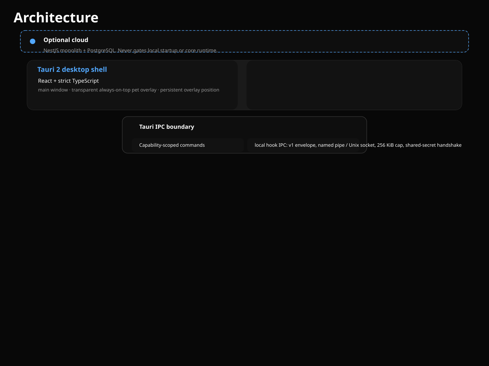
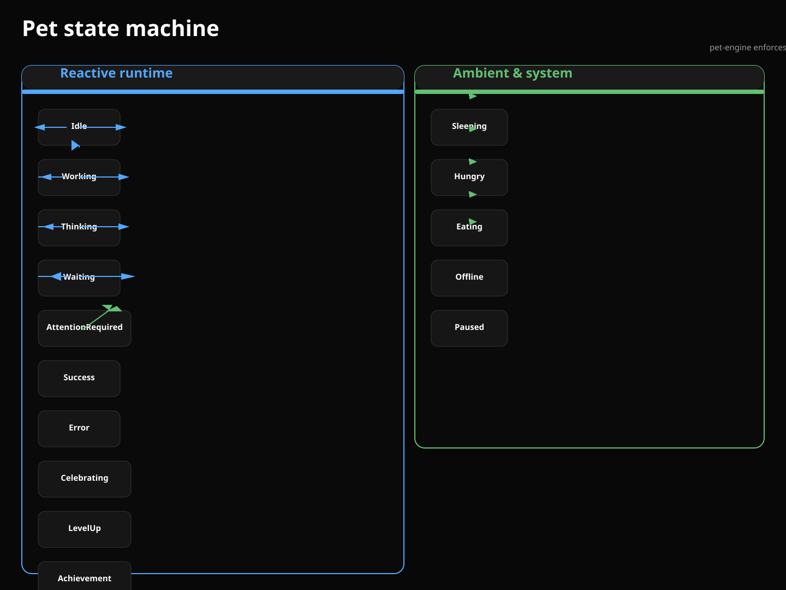
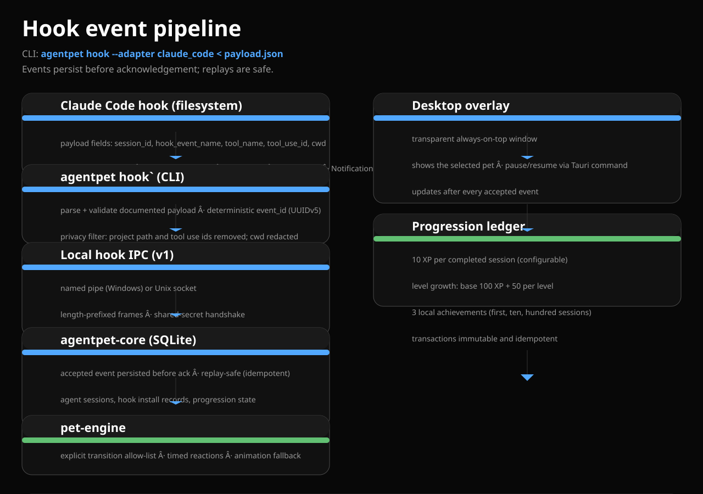

# Miyora

> **Agent behavior, made visible.** An offline-first desktop companion for coding-agent activity, local pet progression, and session evidence.

Miyora is the public, Miyora-branded surface of the AgentPet platform. The internal crate boundary (`agentpet-*`), workspace root crate (`nezuko`), CLI binary, and commands are unchanged; only the public branding and documentation have been renewed.

This README is written from **confirmed code behavior**, not from stale specification documents. Diagrams live in `assets/diagrams/` and branding in `assets/branding/`.









## What Miyora does

- **Desktop companion.** A Tauri 2 desktop shell with a React + strict TypeScript main window and a transparent, always-on-top pet overlay that persists its position across sessions.
- **Real agent observation.** Observe coding agents through a native Claude Code hook or through the universal process wrapper (`agentpet run -- <command>`).
- **Local progression.** A selected pet is captured when a session starts; XP is awarded only when the child process exits successfully. Session XP and level are committed together.
- **Data-only pet packs.** Characters are replaceable packs. Bundle a manifest, assets, license metadata, and state/animation mappings; load, validate, install, and preview them locally.
- **3D characters.** Choose from 142 original 3D characters, customize them, sculpt one from your own image, or import a VRM model. The character's pose, expression, and props follow the real agent state, and its pedestal ring shows real XP progress. See [docs/specs/avatar_3d.md](docs/specs/avatar_3d.md).
- **Always local.** SQLite is the only persistence layer, reachable only from Rust. No login, telemetry, or cloud reach is required to render a pet or read progress.

## Project status (verified)

| Area | Status |
| --- | --- |
| Tauri 2 + React strict TypeScript desktop shell with main window and pet overlay | Implemented |
| Rust SQLite event/session/progression/achievement core | Implemented |
| Universal wrapper (`agentpet run -- <cmd>`): real child, stdout/stderr streams, normal exit codes | Implemented |
| Native Claude Code hook: reversible, backup, preserves unrelated entries | Implemented |
| `agentpet hook` for the other four adapters via the unified wrapper | Implemented |
| Image to static companion (PNG, JPEG, GIF, WebP) with preview generation | Implemented |
| PetPack manifest validation, archive install, Ed25519 signature verification | Implemented (library) |
| 15-state explicit priority-based pet state machine with timed reactions | Implemented |
| Session XP, level, and immutable idempotent achievements | Implemented |
| 3D characters: 142 original procedural characters (5 body types, 30 in popular anime archetypes) with jointed rigs, anime-style faces, hair, and cloth, and state-driven poses and expressions | Implemented |
| Character customization (body, ears, tail, wings, 12 hair styles with gradient tips, eyes, 15 outfits, 6 fabric patterns, 18 accessories, palette, proportions, energy) validated in Rust | Implemented |
| Image to 3D: local silhouette-inflation sculpt to a closed textured GLB, plus a palette-styled rigged character | Implemented (geometric, not a learned model) |
| VRM/GLB avatar import with guardrails, metadata display, and pose retargeting | Implemented |
| `cargo test --workspace` | 111 passed, 0 failed |
| `npx vitest run` in `apps/desktop` | 225 passed, 0 failed (all 142 catalog characters built; each body type animated through all 15 states; patterns, hair tips, outfits, props) |
| `cargo clippy --workspace --all-features --all-targets -D warnings` | 0 warnings, 0 errors |
| `cargo fmt --check --all` | clean |
| `npm run build` in `apps/desktop` (`tsc -b` + `vite`) | passes |

## Commands

> The binary is built with `cargo run -p agentpet-cli`. Binaries and install targets are a work in progress; use the `cargo run -p agentpet-cli` form in this README.

| Command | Subcommand/args | What it does |
| --- | --- | --- |
| `agentpet run` | `-- <command> [args...]` | Wrap and run a real child process; prints stdout/stderr through and records start/end/duration/status. |
| `agentpet status` | | Report persisted pet state, selected companion, recent running sessions, and the most recent accepted event. |
| `agentpet pets` | `list` | List installed PetPacks and mark the selected one. |
| `agentpet agents` | `list` | List known agent adapters. |
| `agentpet agents` | `install <id>` | Install the Claude Code native hook (only `claude_code` is installer-supported). |
| `agentpet agents` | `remove <id>` | Reversibly remove the Claude Code native hook; unrelated settings are preserved. |
| `agentpet agents` | `status [<id>]` | Report recorded hook state and the live hook setting for an adapter. |
| `agentpet hook` | `--adapter claude_code < payload.json` | Parse and validate a Claude Code hook payload into a normalized event on stdin; persists it to the core. |
| `agentpet doctor` | | Check platform, CLI path, local data directory, database access, installed-pack count, and PATH entries for `claude`, `codex`, `gemini`, `aider`, and `opencode`. |

## Architecture

The desktop boundary is Tauri 2 with Rust for the runtime and SQLite for persistence; the UI is React with strict TypeScript. Rust owns authoritative event handling, pet state, session lifecycle, progression, and pack validation. The UI accesses only explicit Tauri commands.

```text
Optional cloud - NestJS monolith + PostgreSQL.
Never gates local startup or core runtime.
        |  (dash: optional)
Tauri 2 desktop shell · React + strict TypeScript
  main window · transparent always-on-top pet overlay · persistent overlay position
        |
Tauri IPC boundary
  capability-scoped commands  ·  local hook IPC: v1 envelope, named pipe / Unix socket, 256 KiB cap, shared-secret handshake
        |
Rust domain
  agentpet-core - SQLite (events, sessions, packs, progression, achievements) · universal wrapper · XP/achievement ledger
  pet-engine - 15 states · explicit transition allow-list · priority-based, timed reactions · animation fallback
  pet-pack + adapters - manifest v1, image to companion, archive install + Ed25519 signature, VRM guardrails
  claude_code native hook · universal wrapper
        |
Sources
  universal wrapper (`agentpet run -- <cmd>`) · Claude Code native hook · user images (PNG, JPEG, GIF, WebP) · PetPack folders and archives
        |
Persistence
  SQLite · local only · Rust-only access · OS credential store · no keys, prompts, or project paths stored
```
## Pet Packs

A pack declares its identity, creator, license, source, attribution, assets, and state/animation mappings as data only. Packs are installed from a staging area after archive, schema, asset, and license metadata validation. Pack scripts and binaries are never executed. Missing animation mappings fall back to a defined default; no failure is raised.

When a user selects an image, the core decodes it (PNG, JPEG, GIF, or WebP), normalizes it into a companion, generates a preview from the first decoded frame, and stores it locally. GIF/WebP are previewed as animated sprite sheets, not as bundled video playback.

## Progression and achievement

- **Sessions.** 10 XP per completed session (configurable); no XP for failed or interrupted commands; token usage is recorded only when a provider adapter supplies measured counts.
- **Level.** Level starts at 100 XP and gains 50 XP per level.
- **Achievements.** Three local achievements (first, ten, hundred completed sessions) are recorded immutably.
- **Persistence.** XP transactions are immutable and idempotent: replays never award duplicate XP or achievements.

## Development and verification

```powershell
# Frontend (from apps/desktop)
npm install
npm run build

# Rust workspace (from the repo root)
cargo fmt --check --all
cargo clippy --workspace --all-features --all-targets -D warnings
cargo test --workspace
```

The desktop shell is started with `npm run tauri dev` from `apps/desktop`. The backend binary is run from the workspace root as `cargo run -p agentpet-cli -- <subcommand> [args...]`.

## Product constraints

- No simulated agent activity, token counts, or session completion.
- No code execution from PetPacks.
- No API keys, prompts, terminal output, or full project paths stored or uploaded by default.
- No cloud login requirement for pet rendering, local events, history, or progression.
- Character assets require creator, license, source, and attribution metadata; the application must not bundle unlicensed copyrighted character art.

## Documentation

- [AGENTS.md](AGENTS.md) — mandatory coding-agent rules.
- [ARCHITECTURE.md](ARCHITECTURE.md) — selected stack and system design.
- [PET_PACK_SPEC.md](PET_PACK_SPEC.md) — data-only pack format and validation.
- [docs/specs/avatar_3d.md](docs/specs/avatar_3d.md) — 3D character spec, catalog, image sculpting, VRM import, and storage.
- [AGENT_PROVIDER_SPEC.md](AGENT_PROVIDER_SPEC.md) — agent and provider contracts.
- [DATABASE.md](DATABASE.md) — local/cloud data model and migration rules.
- [API.md](API.md) — local hook IPC and cloud API contracts.
- [SECURITY.md](SECURITY.md) and [PRIVACY.md](PRIVACY.md) — trust boundaries and data handling.
- [DEVELOPMENT.md](DEVELOPMENT.md), [CONTRIBUTING.md](CONTRIBUTING.md), [DEPLOYMENT.md](DEPLOYMENT.md) — contributor and release workflow.

